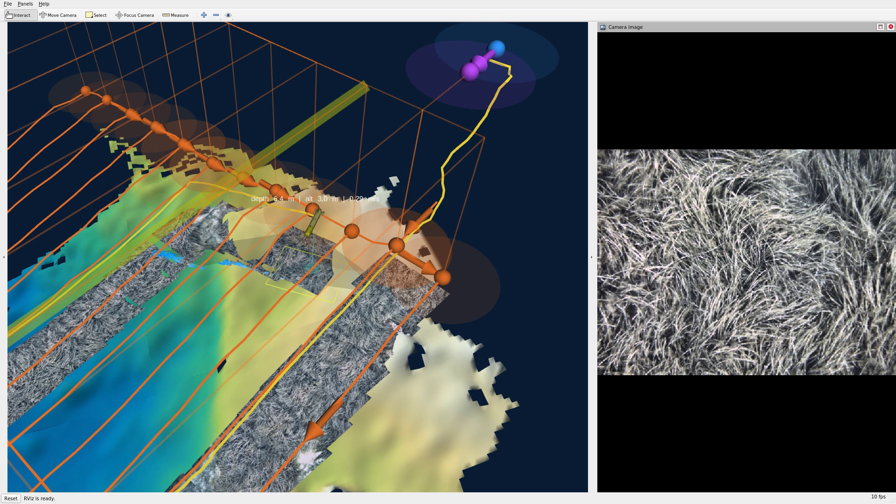
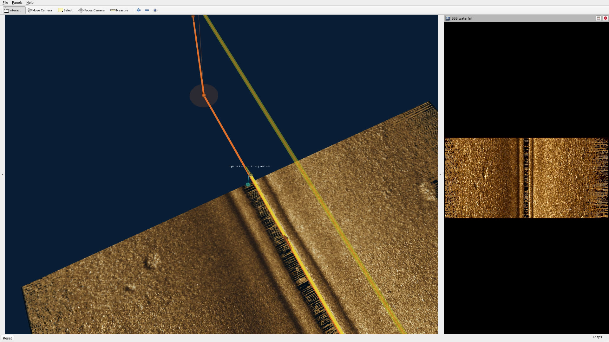
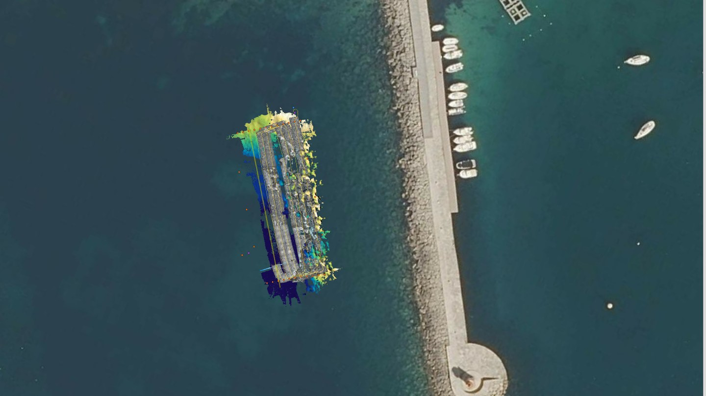
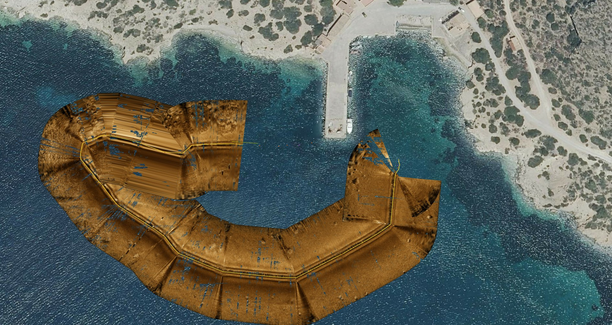

# maris_dataviz_ws

ROS Noetic workspace to replay raw bagfiles of the Orat (Sparus II) AUV and
visualize them in RViz in 3D:

- **Navigation**: vehicle model, travelled trail, altitude line and telemetry.
- **Mission plan**: COLA2 mission (goto / section / park) with altitude-referenced
  legs placed over the measured seafloor.
- **Camera**: down-looking stereo images undistorted, colour-enhanced and
  projected on the seafloor as a growing textured photomosaic.
- **Side-scan sonar**: slant-range corrected, gain-normalised pings projected on
  the seafloor as a textured mosaic, plus a scrolling waterfall.
- **Multibeam**: incremental hill-shaded bathymetry grid, live swath and beam fan.
- **Satellite layer**: aerial orthophoto of the area draped just below
  the measured seafloor, as a reference background.

**Optical profile** — camera photomosaic and multibeam bathymetry (Andratx, lawnmower survey):



**SSS profile** — side-scan sonar mosaic and waterfall (Cabrera):



**Mission areas from afar** — satellite layer under the data (Andratx, Cabrera):





The RViz layout adapts to the data in the mission (`sss`, `optical` or `full`),
and the part of the mission before data collection starts is fast-forwarded.

## Contents

| Path | Description |
|---|---|
| `src/maris_dataviz` | Replay and visualization package |
| `src/orat_description` | Vehicle description (git submodule, used for the vehicle mesh) |

## Requirements

- Ubuntu 20.04, ROS Noetic (`rviz`, `rosbag`, `tf2_ros`, `compressed_image_transport`)
- Python 3: `numpy`, `scipy`, `opencv-python`, `PyYAML`
- For video recording: `ffmpeg` and `xserver-xephyr`

Vendor message packages (COLA2, sonar drivers) are **not** required: custom
messages are decoded with the definitions stored in the bags.

## Build

```bash
git clone --recursive git@github.com:martorelltorres/maris_dataviz_ws.git
cd maris_dataviz_ws
source /opt/ros/noetic/setup.bash
catkin build maris_dataviz
source devel/setup.bash
```

`orat_description` depends on `cola2_lib_ros`; it does not need to be built,
only its mesh is used.

## Data layout

Bagfiles are not versioned. Each mission is a folder with the bags recorded by
the vehicle:

```
bagfiles/<site>/<date>/<mission>/
  sparus2_<stamp>_0.bag                 navigation, mission, TF (required)
  sparus2_sidescan_<stamp>_0.bag        side-scan sonar
  sparus2_multibeam_<stamp>_0.bag       multibeam
  sparus2_stereo_camera_<stamp>_N.bag   stereo camera (may be split)
  sparus2_<stamp>_0_latlon.csv          optional, used to detect when the vehicle starts moving
```

## Usage

```bash
roslaunch maris_dataviz replay_mission.launch mission_dir:=/path/to/mission_folder
```

Predefined datasets (relative to `bagfiles/`):

```bash
roslaunch maris_dataviz replay_mission.launch dataset:=sss       # cabrera/2025_10_28/10_56_48
roslaunch maris_dataviz replay_mission.launch dataset:=optical   # andratx/2026_07_02/13_52_22
```

Main arguments:

| Argument | Default | Description |
|---|---|---|
| `rate` | `1.0` | Playback rate |
| `start` / `duration` | `0` | Seconds to skip / to play (0 = all) |
| `skip_to_data` | `true` | Fast-forward (navigation only) until sensor data collection starts |
| `wait_motion` | `true` | Also wait until the vehicle starts moving |
| `ff_rate` | `20` | Fast-forward rate |
| `profile` | `auto` | RViz layout: `auto`, `sss`, `optical`, `full` |
| `camera` / `sss` / `multibeam` | `true` | Enable each sensor |
| `satellite` | `true` | Aerial orthophoto under the seafloor data (needs internet the first time) |
| `camera_side` | `port` | Stereo camera used for projection |
| `mission_line_width` | `0.25` | Width of the mission legs (m) |
| `loop` / `pause` | `false` | Loop playback / start paused |

Pause and resume:

```bash
rosservice call /player/pause_playback true
rosservice call /player/pause_playback false
```

## Recording a video

```bash
rosrun maris_dataviz record_mission.sh OUTPUT.mp4 PROFILE [launch args]
rosrun maris_dataviz record_mission.sh ~/videos/sss.mp4 sss dataset:=sss duration:=600
```

RViz runs in a nested X server (Xephyr) with its own ROS master, so the
recording is independent of the desktop. Bags are played at `REC_RATE`
(default 0.5) and the video is re-timed to real mission speed. Other settings:
`REC_SIZE` (1920x1080), `REC_FPS` (30), `REC_CRF` (14).

## Nodes

| Node | Role |
|---|---|
| `play_mission.py` | Finds the mission bags and plays them with `rosbag play --clock` |
| `nav_relay.py` | TF tree (world, world_ned, vehicle, sensors), vehicle model, trail, altitude |
| `mission_viz.py` | Mission plan markers (legs on a separate topic) and sea surface |
| `camera_projector.py` | Seafloor photomosaic and camera footprint |
| `sss_projector.py` | Side-scan mosaic and waterfall |
| `multibeam_mapper.py` | Bathymetry grid and swath fan |
| `satellite_layer.py` | Aerial orthophoto mesh under the mission area |
| `rviz_profile.py` | Starts RViz with the configuration matching the data |

Projections assume a flat seafloor below the vehicle at the measured altitude.
Mosaic tiles are written to `~/.ros/maris_dataviz_cache/`.

## Satellite layer

`satellite_layer.py` (disable with `satellite:=false`) downloads the map tiles covering the
mission area plus a margin (`~margin`, 100 m), stitches them (highest zoom up to
`~max_zoom` 19 that fits a `~max_texture` of 4096 px) and publishes a textured mesh
that follows the seafloor measured during the mission (depth + altitude),
`~depth_offset` (0.5 m) below it so mosaics and bathymetry stay on top. Tiles are
cached in `~/.ros/maris_dataviz_cache/satellite/`.

The default source is the PNOA orthophoto (Spain only), "PNOA cedido por
© Instituto Geográfico Nacional", CC BY 4.0. Other XYZ sources can be set with
`~tile_url` (`{z}`, `{x}`, `{y}` placeholders), subject to their own terms. The image
shows the sea surface: the seabed is only visible in clear, shallow water.
